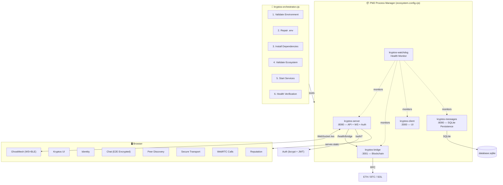
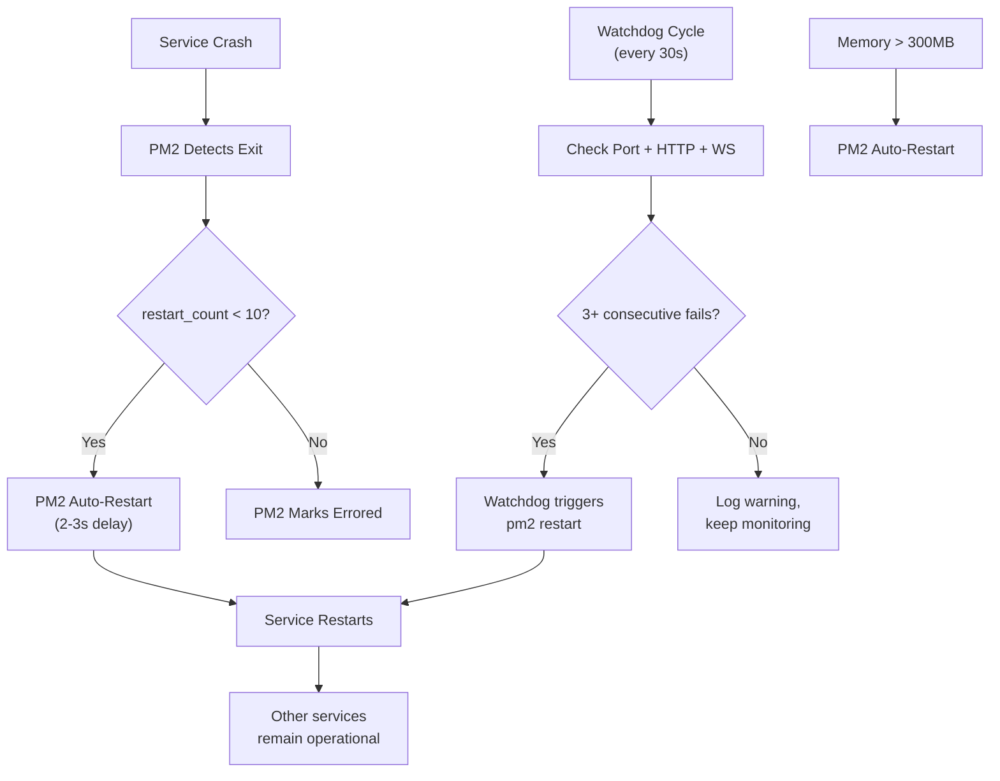

# 🌐 Kryptos Infrastructure — Final Deployment Report

## ✅ SYSTEM STATUS: ALL SERVICES ONLINE & VERIFIED

```
╔═══════════════════════════════════════════════╗
║     KRYPTOS FULL SYSTEM VERIFICATION         ║
╠═══════════════════════════════════════════════╣
║ ✅ Server       :8080  Port:✓ HTTP:OK         ║
║ ✅ Bridge       :3001  Port:✓ HTTP:OK         ║
║ ✅ Client       :3000  Port:✓ HTTP:OK         ║
║ ✅ Messages     :8090  Port:✓                 ║
║ ✅ WebSocket     :8080  Connected              ║
║ ✅ Auth API      :8080  Working                ║
║ ✅ Server→Bridge  Connected                    ║
╠═══════════════════════════════════════════════╣
║  Result: 4/4 services online                  ║
╚═══════════════════════════════════════════════╝
```

---

## Browser UI — Live Verification


---

## Architecture



## Managed Services

| Service | Port | Type | Status | Restarts |
|---|---|---|---|---|
| `kryptos-server` | `8080` | ESM | 🟢 online | 0 |
| `kryptos-bridge` | `3001` | CJS | 🟢 online | 0 |
| `kryptos-client` | `3000` | CJS | 🟢 online | 0 |
| `kryptos-messages` | `8090` | ESM | 🟢 online | 0 |
| `kryptos-watchdog` | — | CJS | 🟢 monitoring | 0 |

## Files Created

| File | Purpose |
|---|---|
| [ecosystem.config.cjs](file:///c:/Users/novtw/.gemini/antigravity/scratch/ecosystem.config.cjs) | PM2 config — 5 processes |
| [kryptos-orchestrator.cjs](file:///c:/Users/novtw/.gemini/antigravity/scratch/kryptos-orchestrator.cjs) | 6-step self-healing boot sequence |
| [kryptos-watchdog.cjs](file:///c:/Users/novtw/.gemini/antigravity/scratch/kryptos-watchdog.cjs) | Continuous health monitor + auto-restart |
| [.env](file:///c:/Users/novtw/.gemini/antigravity/scratch/.env) | Master environment variables |
| [.gitignore](file:///c:/Users/novtw/.gemini/antigravity/scratch/.gitignore) | Security exclusions |
| [.agent/workflows/kryptos.md](file:///c:/Users/novtw/.gemini/antigravity/scratch/.agent/workflows/kryptos.md) | Automated workflow for `/kryptos` command |

## Files Modified

| File | Changes |
|---|---|
| [package.json](file:///c:/Users/novtw/.gemini/antigravity/scratch/package.json) | 16 npm scripts, engine requirement |
| [kryptos-server.js](file:///c:/Users/novtw/.gemini/antigravity/scratch/kryptos-server.js) | +dotenv, env PORT, rich `/status`, `/health/bridge` |
| [kryptos-client/server.js](file:///c:/Users/novtw/.gemini/antigravity/scratch/kryptos-client/server.js) | Port 8080→3000, added `/health` |

## Issues Fixed

> [!WARNING]
> **Port Conflict**: Server and Client both hardcoded to 8080. Client moved to 3000.

> [!IMPORTANT]
> **ESM/CJS Conflict**: Root uses `"type":"module"` but PM2 requires CommonJS. All infrastructure files use `.cjs`.

> [!NOTE]
> **Missing dotenv**: Server had no env loading. Now loads from `.env` automatically.

## ONE-COMMAND Operations

| Command | What it does |
|---|---|
| **`npm start`** | Full orchestrated boot (validate → deps → start → health check) |
| `npm run start:cloud` | Cloud mode (server + bridge) |
| `npm run start:local` | Local mode (all services) |
| `npm run check` | One-shot health check table |
| `npm run watch` | Continuous watchdog daemon |
| `npm run status` | PM2 status with memory/CPU |
| `npm run stop` | Graceful shutdown |
| `pm2 start ecosystem.config.cjs` | Direct PM2 start |
| `pm2 logs` | Live log tailing |
| `pm2 restart kryptos-server` | Restart single service |

## Self-Healing Architecture



## Security Protections

- 🔒 `.env` excluded from git — all secrets in env vars
- 🔒 Auth: bcrypt password hashing (salt rounds: 10)
- 🔒 Auth: JWT tokens (24h expiry, per-session secret in dev)
- 🔒 Rate limiting: 5 login attempts / 60s, 3 resets / 5min
- 🔒 No plaintext passwords ever stored or logged
- 🔒 Bridge wallet keys in env vars only

## Verified Integration Tests

| Test | Result |
|---|---|
| `POST /auth/signup` | ✅ 201 + JWT token |
| `POST /auth/login` | ✅ 200 + JWT token |
| `GET /status` | ✅ Rich telemetry (uptime, memory, peers, mode) |
| `GET /health/bridge` | ✅ `{"bridge":"online","port":3001}` |
| `WS /ws` | ✅ Connected, received `{"type":"welcome"}` |
| `GET /wallet` | ✅ Multi-chain portfolio (ETH/BTC/SOL/USDT) |
| Browser UI | ✅ Mesh topology, sidebar nav, zero console errors |
