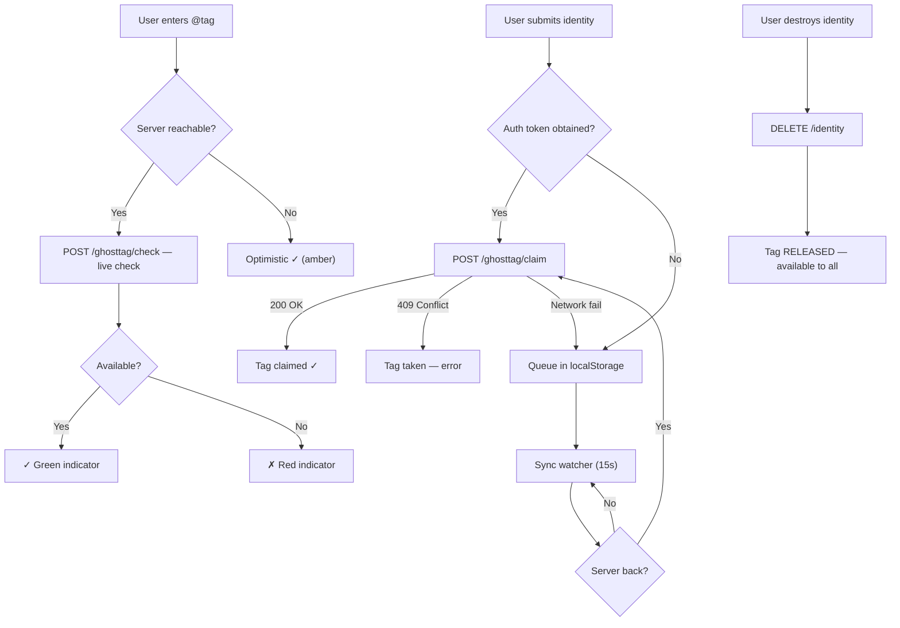

# GhostTag Username System — Implementation Summary

## What Was Built

A complete, offline-first GhostTag username system linking `@username` tags to cryptographic identities.

---

## Architecture



## Files Modified/Created

| File | Action | Purpose |
|------|--------|---------|
| [ghosttag.js](file:///c:/Users/novtw/.gemini/antigravity/ghosttag.js) | **Created** | Complete client-side GhostTag module with offline-first sync |
| [kryptos-server.js](file:///c:/Users/novtw/.gemini/antigravity/kryptos-server.js) | **Modified** | Added `ghosttag.js` and `kryptos-sync.js` to static file allowlist |
| [index.html](file:///c:/Users/novtw/.gemini/antigravity/index.html) | **Modified** | Integrated GhostTag module into IdentityUI (load script, claim, check, destroy, sync) |
| [ui.js](file:///c:/Users/novtw/.gemini/antigravity/ui.js) | **Modified** | Added GhostTag cleanup to `clearSession(destroy=true)` |

## Key Features Implemented

### 1. No Duplicate Tags — Case-Insensitive
- All tags are normalized to lowercase before storage/comparison
- Server enforces uniqueness via the `ghostTags` registry
- Client validates with `GhostTag.validate()` and checks with `GhostTag.checkAvailability()`

### 2. Permanent Lock Until Account Deletion
- Once claimed, a tag cannot be transferred or renamed
- No change/rename endpoint exists on the server
- Only `DELETE /identity` or `DELETE /ghosttag/release` frees the tag

### 3. Tag Released on Account Deletion
- `destroyIdentity()` → `GhostTag.deleteIdentity()` → `DELETE /identity` on server
- Server releases the tag from the `ghostTags` registry and saves to disk
- Tag becomes immediately available to all other users

### 4. Offline Registration & Sync
- If server is unreachable during claim:
  - Tag is saved locally in `kryptos_ghost_tag`
  - Full claim data stored in `kryptos_pending_tag_claim_data`
  - Flag `kryptos_pending_tag_claim` set to `'true'`
- **Sync watcher** runs every 15s checking for connectivity
- Listens to `online`/`offline` browser events for instant sync on reconnect
- On successful sync: clears pending data, dispatches `ghosttag:sync` event
- On conflict (tag taken by someone else while offline): stores conflict data, shows toast notification

### 5. Real-Time Availability Check
- Debounced (500ms) live check as user types
- Shows ✓ green for available, ✗ red for taken
- Shows ✓ amber when server offline (optimistic) with tooltip: "Server offline — will verify when online"

## GhostTag Module API (`window.GhostTag`)

```javascript
// Core operations
GhostTag.checkAvailability(tag)     // → { available, tag, offline? }
GhostTag.claimTag(tag, identity)    // → { success, tag, pending? }
GhostTag.resolveTag(tag)            // → { tag, nodeId, publicKey, ... }
GhostTag.releaseTag()               // → { success, released }
GhostTag.deleteIdentity()           // → { success, releasedTag }

// Local state
GhostTag.getLocalTag()              // → 'username' or null
GhostTag.getStatus()                // → { status, tag, message }

// Offline sync
GhostTag.getPendingClaim()          // → claim data or null
GhostTag.syncPendingClaim()         // → { success?, conflict?, deferred? }
GhostTag.startSyncWatcher()         // starts 15s interval
GhostTag.stopSyncWatcher()          // stops interval

// Conflict resolution
GhostTag.getSyncConflict()          // → conflict data or null
GhostTag.clearSyncConflict()        // clears conflict

// Helpers
GhostTag.getInviteLink(tag?)        // → 'kryptos.n11x.dev/invite/@username'
GhostTag.getShareText(tag?)         // → shareable text with link
GhostTag.validate(tag)              // → { valid, tag?, error? }
GhostTag.normalize(tag)             // → 'username' (lowercase, trimmed)
```

## Security Considerations

> [!IMPORTANT]
> - Tags are bound to the JWT-authenticated user's `nodeId`
> - Server enforces one tag per user, one user per tag
> - Claims require valid `Authorization: Bearer <jwt>` header
> - Rate limiting protects check and claim endpoints
