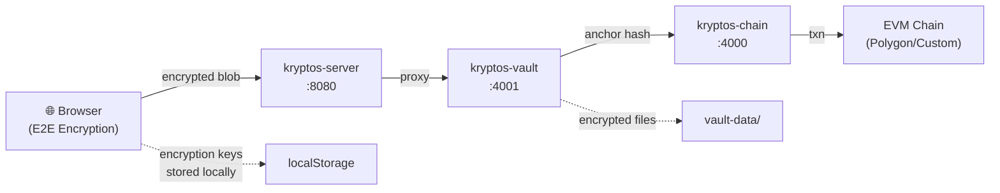

# 🔒 Encrypted File Vault — Implementation Walkthrough

## Architecture Overview

The File Vault consists of **3 new layers** that integrate with the existing Kryptos architecture:



> [!IMPORTANT]
> **Zero-knowledge design**: The server NEVER sees plaintext files or encryption keys. All encryption happens in the browser using Web Crypto API (AES-256-GCM).

---

## New Services

| Service | Port | Role |
|---------|------|------|
| **kryptos-chain** | 4000 | Blockchain abstraction layer — the ONLY service that talks to blockchain |
| **kryptos-vault** | 4001 | File storage backend — stores encrypted blobs, calls Chain service for anchoring |

## New Files

### Backend
| File | Purpose |
|------|---------|
| [chain-service.js](file:///c:/Users/novtw/.gemini/antigravity/scratch/kryptos-chain/chain-service.js) | Chain Service HTTP API |
| [base-provider.js](file:///c:/Users/novtw/.gemini/antigravity/scratch/kryptos-chain/providers/base-provider.js) | Abstract provider interface |
| [evm-provider.js](file:///c:/Users/novtw/.gemini/antigravity/scratch/kryptos-chain/providers/evm-provider.js) | EVM implementation (Polygon/Hardhat/custom) |
| [index.js](file:///c:/Users/novtw/.gemini/antigravity/scratch/kryptos-chain/providers/index.js) | Provider factory (singleton) |
| [vault-service.js](file:///c:/Users/novtw/.gemini/antigravity/scratch/kryptos-vault/vault-service.js) | Vault Service — file storage + chain anchoring |

### Frontend
| File | Purpose |
|------|---------|
| [kryptos-file-vault.js](file:///c:/Users/novtw/.gemini/antigravity/scratch/kryptos-file-vault.js) | Client-side E2E encryption module (AES-256-GCM) |

### Modified Files
| File | Changes |
|------|---------|
| [index.html](file:///c:/Users/novtw/.gemini/antigravity/scratch/index.html) | New vault section UI: drag-drop, progress, file grid |
| [ui.css](file:///c:/Users/novtw/.gemini/antigravity/scratch/ui.css) | +390 lines of vault-specific styles |
| [ui.js](file:///c:/Users/novtw/.gemini/antigravity/scratch/ui.js) | +260 lines: VaultUI methods (upload, render, download, delete, verify) |
| [kryptos-server.js](file:///c:/Users/novtw/.gemini/antigravity/scratch/kryptos-server.js) | Vault proxy routes (/vault/* → vault service) |
| [ecosystem.config.cjs](file:///c:/Users/novtw/.gemini/antigravity/scratch/ecosystem.config.cjs) | Added chain + vault PM2 services |
| [docker-compose.yml](file:///c:/Users/novtw/.gemini/antigravity/scratch/docker-compose.yml) | Added chain + vault containers |
| [.env.example](file:///c:/Users/novtw/.gemini/antigravity/scratch/.env.example) | Chain/vault environment variables |

---

## Security Model

```
┌─────────────────────────────────────────────────┐
│  BROWSER (User's Device)                        │
│  ┌─────────────────────────────────────────────┐│
│  │ 1. User drops file                          ││
│  │ 2. Generate AES-256-GCM key + IV            ││
│  │ 3. Encrypt entire file in-browser           ││
│  │ 4. Store key in localStorage ONLY           ││
│  │ 5. Upload encrypted blob                    ││
│  └─────────────────────────────────────────────┘│
└─────────────────────────────────────────────────┘
              │ (only encrypted data leaves browser)
              ▼
┌─────────────────────────────────────────────────┐
│  VAULT SERVICE (Server)                         │
│  • Receives: encrypted blob (ciphertext)        │
│  • Stores:   encrypted file to disk             │
│  • Computes: SHA-256 hash of ciphertext         │
│  • Sends:    hash to Chain Service for anchoring│
│  • NEVER has: plaintext, key, ability to decrypt│
└─────────────────────────────────────────────────┘
              │
              ▼
┌─────────────────────────────────────────────────┐
│  CHAIN SERVICE (Blockchain)                     │
│  • Stores:   file hash + metadata on-chain      │
│  • Provides: immutable proof of existence        │
│  • Enables:  integrity verification              │
│  • Can be:   Polygon, custom EVM, or any chain   │
└─────────────────────────────────────────────────┘
```

> [!CAUTION]
> Encryption keys are stored ONLY in the user's browser `localStorage`. If the user clears browser data, the keys are lost and files become unrecoverable. In a production system, implement key backup/export.

---

## Blockchain Abstraction Layer

> [!TIP]
> To switch from Polygon to a custom EVM chain, change ONE environment variable:
> ```bash
> KRYPTOS_CHAIN_PROVIDER=custom-evm
> ETH_RPC_URL=https://your-custom-chain-rpc.example.com
> ETH_PRIVATE_KEY=0x...
> ```
> Zero app code changes required.

The abstraction is enforced at the architecture level:

1. **Provider Interface** (`base-provider.js`) — defines what every chain must implement
2. **EVM Provider** (`evm-provider.js`) — implements the interface for EVM chains
3. **Factory** (`index.js`) — creates the right provider based on env config
4. **Chain Service** (`chain-service.js`) — HTTP API that all services call

No service except `kryptos-chain` ever imports ethers.js or calls blockchain functions.

---

## Running

### Local (PM2)
```bash
pm2 start ecosystem.config.cjs
```

### Docker
```bash
docker compose up -d
```

### Manual (development)
```bash
# Terminal 1 — Chain Service
node kryptos-chain/chain-service.js

# Terminal 2 — Vault Service
node kryptos-vault/vault-service.js

# Terminal 3 — Main Server
node kryptos-server.js
```

## API Endpoints

### Chain Service (:4000)
| Method | Endpoint | Description |
|--------|----------|-------------|
| POST | `/chain/anchor` | Anchor file hash on blockchain |
| GET | `/chain/verify/:fileId` | Verify file hash on-chain |
| GET | `/chain/files/:owner` | List files by owner |
| DELETE | `/chain/file/:fileId` | Delete file record |
| GET | `/chain/info` | Chain status info |

### Vault Service (:4001)
| Method | Endpoint | Description |
|--------|----------|-------------|
| POST | `/vault/upload` | Upload encrypted file |
| GET | `/vault/files/:owner` | List user's files |
| GET | `/vault/download/:fileId` | Download encrypted file |
| DELETE | `/vault/file/:fileId` | Delete file |
| GET | `/vault/verify/:fileId` | Verify file integrity |

---

## UI Features

- **Drag & drop** upload with animated drop zone
- **Upload progress** with 4 stages: Encrypting → Uploading → Anchoring → Complete
- **File grid** with chain verification badges (On-Chain / Pending)
- **SHA-256 hash display** for each file
- **Download** — decrypts in-browser and triggers save dialog
- **Verify** — modal showing disk integrity and chain verification status
- **Delete** — confirmation prompt, removes file and marks chain record as deleted
- Files **persist automatically** until explicitly deleted by user
