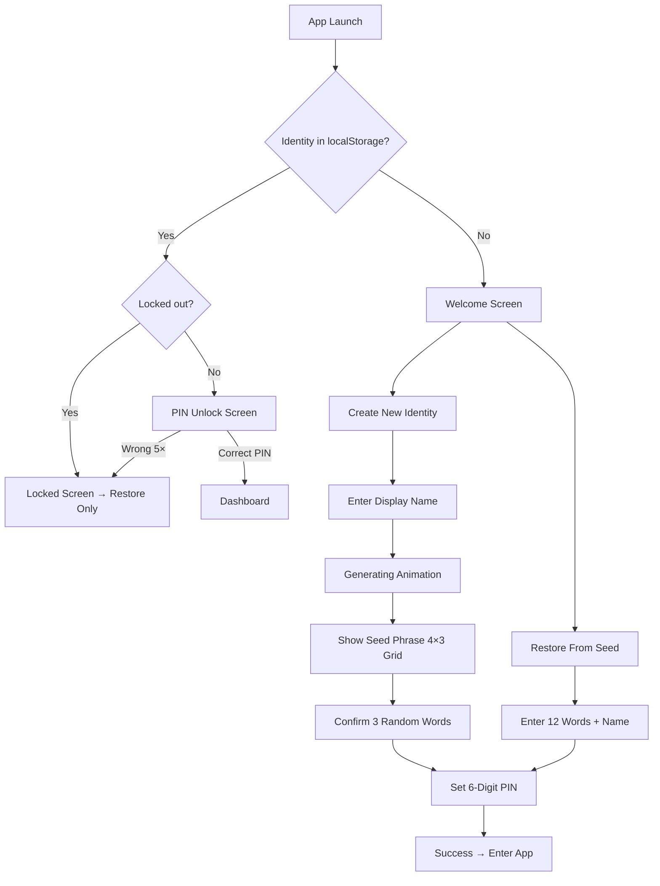

# GhostNet Cryptographic Identity System

## Architecture

## Files Changed

| File | Action |
|---|---|
| [crypto-identity.js](file:///c:/Users/novtw/.gemini/antigravity/scratch/crypto-identity.js) | **NEW** — Core crypto module |
| [index.html](file:///c:/Users/novtw/.gemini/antigravity/scratch/index.html) | Replaced auth section with identity screens |
| [ui.css](file:///c:/Users/novtw/.gemini/antigravity/scratch/ui.css) | Added ~270 lines of identity system CSS |

## Security Model

| Property | Implementation |
|---|---|
| Key Generation | `ethers.Wallet.createRandom()` — CSPRNG |
| Seed Phrase | 12-word BIP39 mnemonic via ethers.js |
| Key Encryption | AES-256-GCM via Web Crypto API |
| Key Derivation | PBKDF2 with 100,000 iterations + SHA-256 |
| PIN Lockout | 5 wrong attempts → full lockout |
| Server Involvement | **Zero** — all ops client-side only |

## What's Stored in localStorage

| Key | Value |
|---|---|
| `ghostnet_enc_pk` | AES-256-GCM encrypted private key |
| `ghostnet_pubkey` | Public key (hex) |
| `ghostnet_address` | Ethereum-style address |
| `ghostnet_display_name` | User's chosen name |
| `ghostnet_node_id` | keccak256(pubkey + name) |
| `ghostnet_pin_attempts` | Failed PIN counter |
| `ghostnet_locked` | Lockout flag |

> [!CAUTION]
> The raw private key and seed phrase are **NEVER** stored anywhere.
> The seed phrase is shown exactly once during onboarding, then wiped from memory.
